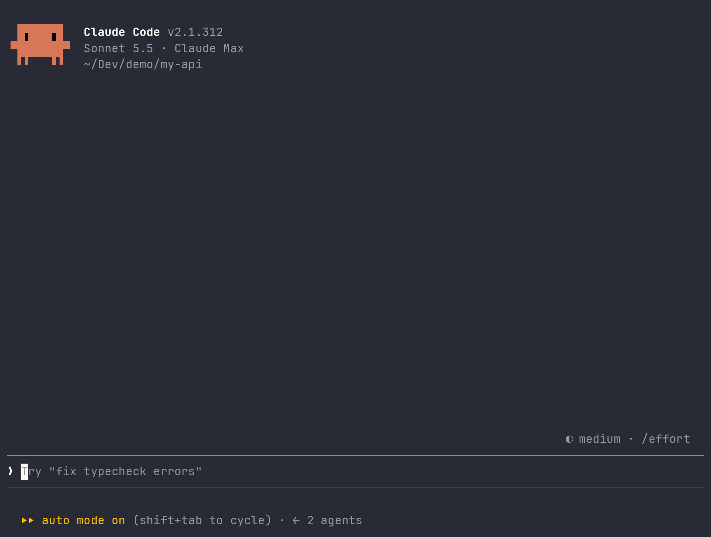

# theway

theway writes a spec and a numbered task list before any code, then implements the tasks in your session or through agents that open a reviewed, CI-green pull request.



*Real Claude Code session on Sonnet, sped up. Idle waits shortened.*

## Install

```bash
npx --yes @pixelfactoryio/theway@latest install
```

Pin to a release:

```bash
npx --yes @pixelfactoryio/theway@X.Y.Z install
```

## Documentation

[pixelfactoryio.github.io/theway](https://pixelfactoryio.github.io/theway/)

## Requirements

- Node.js 22.12 or later
- macOS or Linux
- Claude Code

## Contributing

See [CONTRIBUTING.md](CONTRIBUTING.md).

## License

MIT, see [LICENSE](LICENSE).
