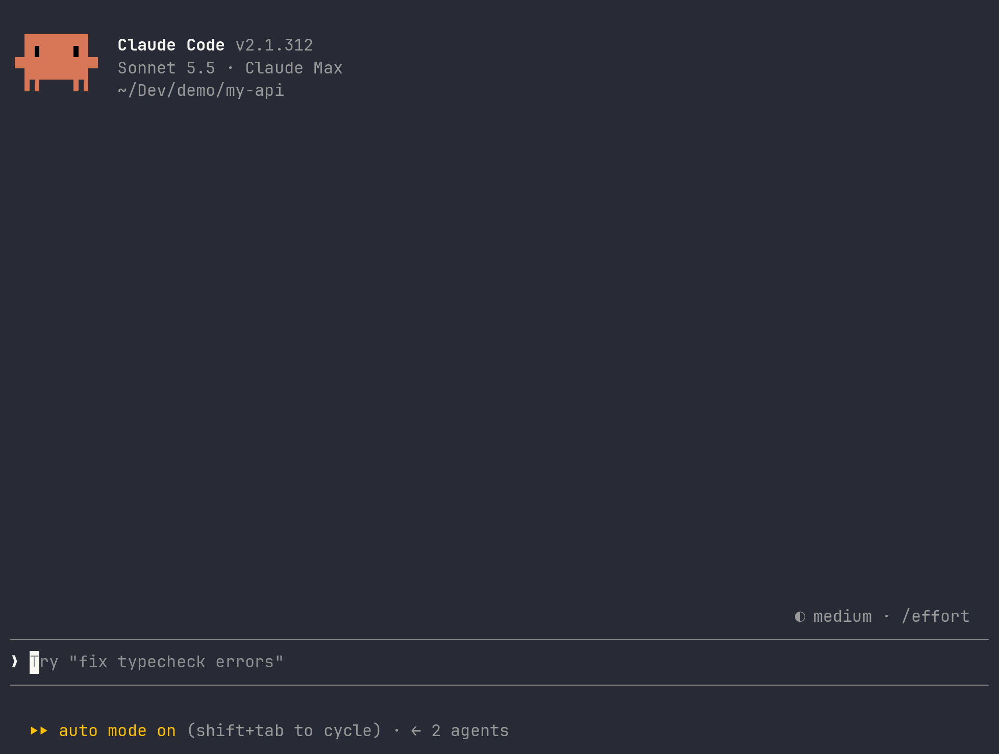

# theway

theway writes a spec and an ordered task list before any code, then implements the tasks in your session or through agents that open a reviewed, CI-green pull request.

The steps are yours: a workflow is a YAML file listing steps, each using a Markdown prompt that answers pass, fail or blocked, run in your session or through agents, with commit conventions and git host commands you can replace per project. Writing the spec is a workflow too: `/theway:engineering` runs the shipped `engineering` workflow, whose investigation, critics and templates are prompts you can change. See [Workflows](https://pixelfactoryio.github.io/theway/docs/concepts/workflows/).



*Real Claude Code session on Sonnet, sped up. Idle waits shortened.*

`theway dashboard` serves a local web view of your changes, workflows and prompts at `http://127.0.0.1:4870/`: a single page built into the CLI, reachable from this machine only, that reads the theway home as it is on every request.

## Install

```bash
npx --yes @pixelfactoryio/theway@latest install
```

Pin to a release:

```bash
npx --yes @pixelfactoryio/theway@X.Y.Z install
```

## Documentation

[pixelfactoryio.github.io/theway](https://pixelfactoryio.github.io/theway/)

## Requirements

- Node.js 22.12 or later
- macOS or Linux
- Claude Code

## Contributing

See [CONTRIBUTING.md](CONTRIBUTING.md).

## License

MIT, see [LICENSE](LICENSE).
